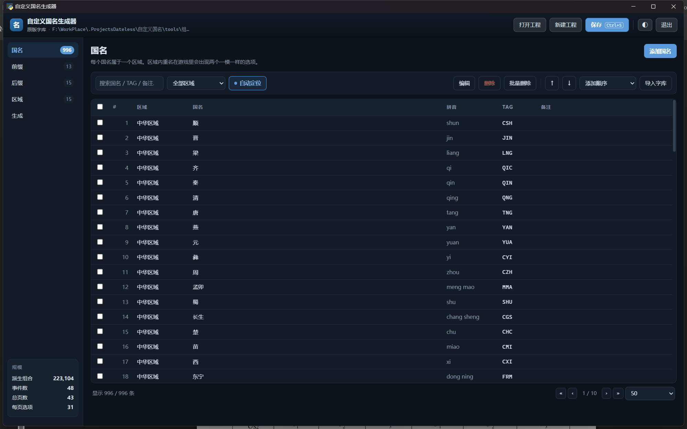
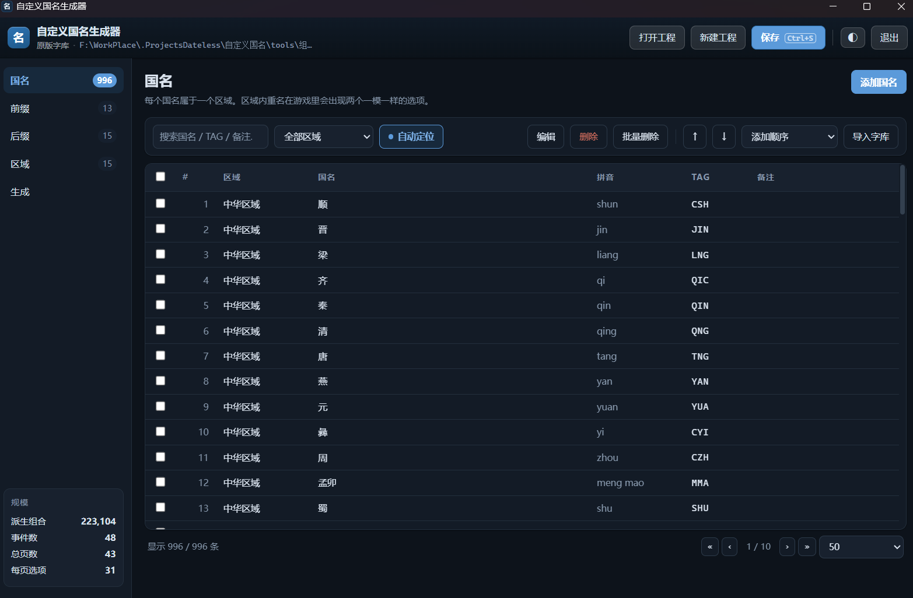
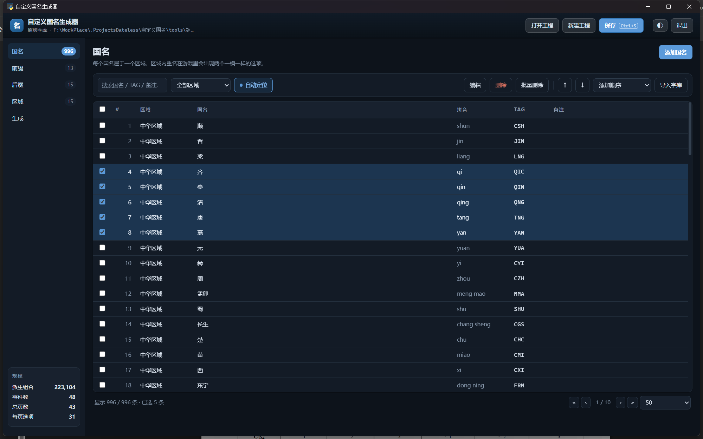
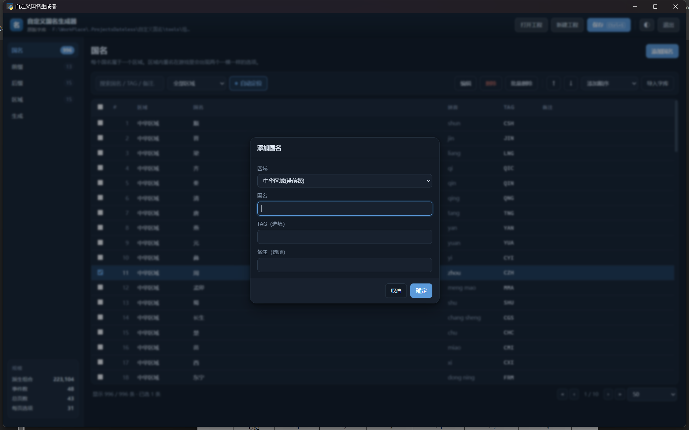
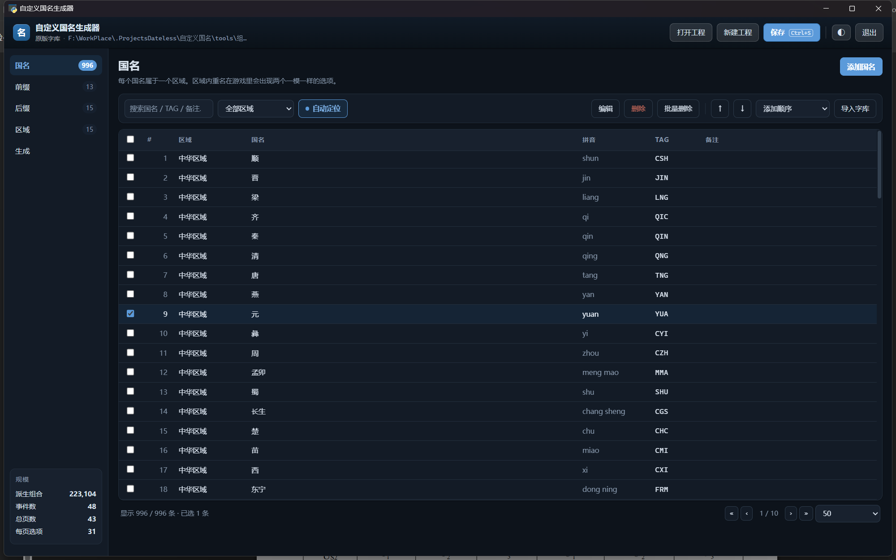
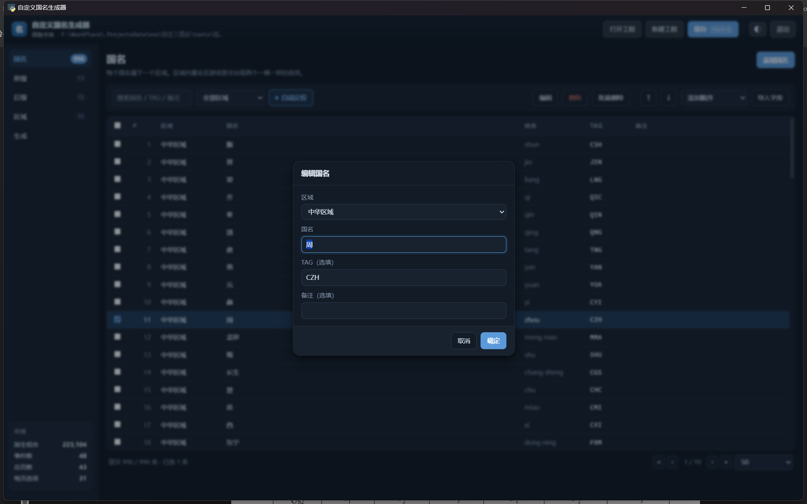
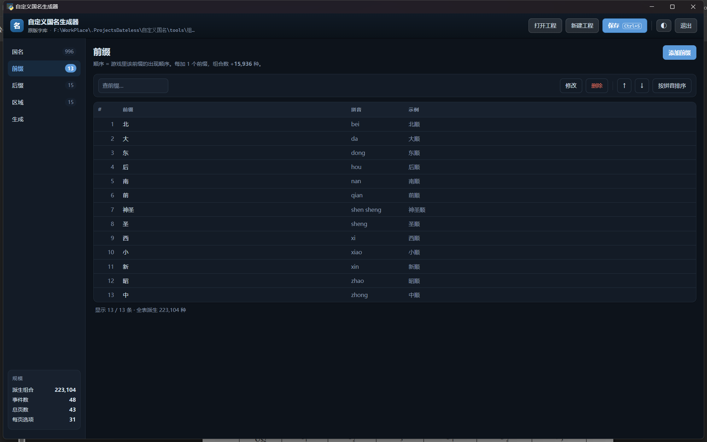
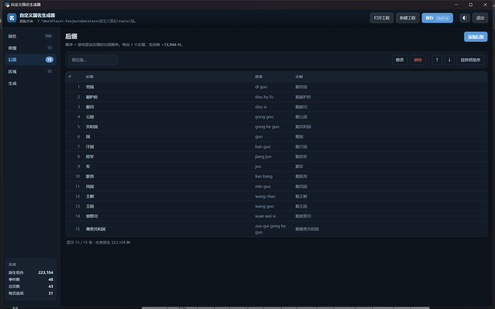
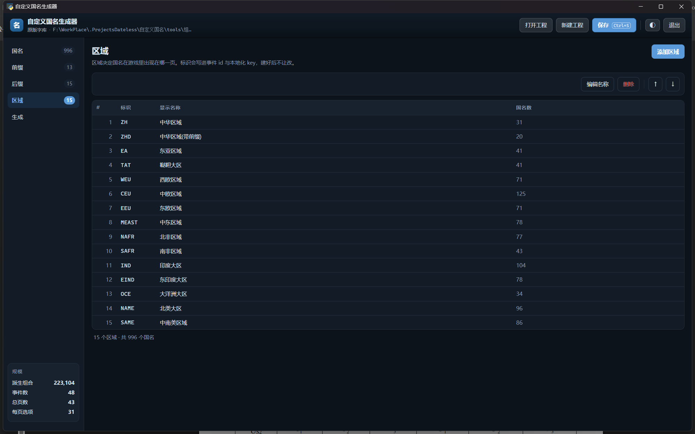
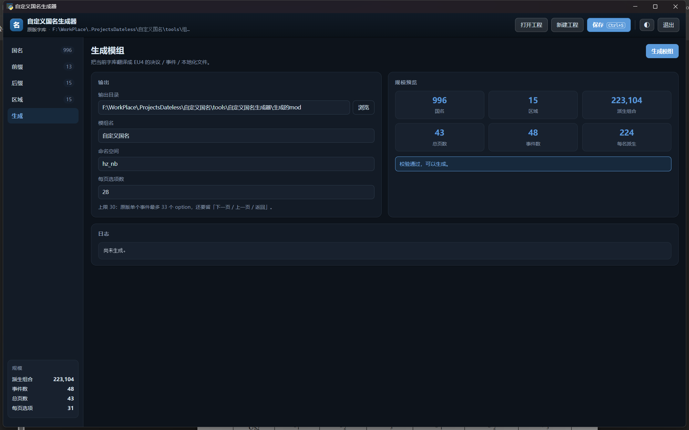

# 组词自定义国名工具 · 用户手册

欢迎使用组词自定义国名模组和工具！（暂不提供英文版）

给「组合造词国名」模组配字库的图形工具：管理国名 / 前缀 / 后缀 / 区域，
一键生成模组文件。本文讲**怎么用**；开发者文档见 [README](../README.md)。

> 铁人模式用不了，联机要跟朋友交换工程文件 —— 这两条务必先看第 8 节。
> 只想赶紧上手的话，翻到第 8.1 节，四步就能生成。

手册里的截图都是真窗口的实拍，出自 `shots.py` 自动截图，跟着界面改版重跑即可。

---

## 1. 认识窗口

双击 `组词自定义国名工具.exe` 打开，长这样：

- **顶栏**：重置路径 / 打开工程 / 新建工程 / 保存（Ctrl+S）/ 另存为 / 深浅主题切换 ◐ / 退出。
- **左侧页签**：国名、前缀、后缀、区域、生成，名字旁边是各自的数量。
- **左下角「规模」**：当前工程的预生成组合数、事件数、总页数、每页选项数，
  改动字库后数字实时跟着变 —— 想知道「再加一个名字会多重」，看这里就行。

窗口是正经的桌面窗口，不是浏览器标签页；大小会自动记住，下次开还一样。

### 深色主题

点顶栏的 ◐ 切换深浅色，**Windows 标题栏会一起变**：docs/

---

## 2. 国名页

日常待得最久的页签。表格列：#、区域、国名、拼音、TAG、备注。

### 找到要的那几条

- **搜索框**：同时匹配国名 / TAG / 备注，边打边筛。
- **区域下拉**：只看某一个区域。
- **分页**：右下角 « ‹ › » 翻页，每页条数可选（50 / 100 / 200 / 500）。

### 选中与多选

- **单击**选中一行，**Shift + 单击** 连选一段，行首复选框可以逐个勾。
  注意：没有 Ctrl 逐个加选这回事，别按着 Ctrl 点了。
- 选中后整行变色，页脚显示「已选 N 条」。

### 添加国名

点页签右上角〔添加国名〕：**区域已经替你选好上次用的那个**，
光标直接落在国名输入框上 —— 连续往同一区域塞名字时不用每次重选。

### 自动定位（推荐开着）

工具栏上的开关，默认开。开了之后，每加完一条会**自动翻到那一行所在的页、
选中它，并蓝闪 1.8 秒**：

如果当前的搜索词或区域筛选正好把新行挡住了，会顺手把筛选清掉，
不然翻过去也看不见。开关状态会记住，重开程序还是上次的值。

### 编辑与删除

- **双击任意一行**就是编辑（或选中一行点〔编辑〕）。
- 〔删除〕删掉勾选的行；〔批量删除〕支持按「当前筛选结果 / 区域内重名 / 全部」删，
  清理重复项时用它。

### 排序

- 右上角排序下拉：一键按区域+拼音等规则整表重排。
- 〔↑〕〔↓〕把选中的一行单独上移 / 下移。
- 排序只影响游戏里出现的顺序，**不影响**「按添加顺序还原」——
  每条国名有个稳定的添加序号，随时可以从排序下拉里恢复。

### 导入字库

〔导入字库〕从「区域-tag-国名对照表.md」整表灌入，已存在的自动跳过。
第一次建工程用它最快。

---

## 3. 前缀页 / 后缀页

两个页签操作完全一样：添加 / 双击编辑 / 删除 / 上移下移 / 按拼音排序。
右侧「示例」列实时显示「前缀＋第一个国名」拼出来是什么样，不用脑补。

**顺序 = 游戏里出现顺序**：决议里选前缀时按这个列表从上往下排，
想把常用的放前面就挪上去（或排完拼音）。

---

## 4. 区域页

添加 / 改名 / 删除 / 上移下移。**顺序 = 游戏里「选择区域」的弹出顺序**，
同样是把常用的放前面。

区域「标识」只在大写字母 / 数字 / 下划线，它会写进事件 id 和本地化 key，
建好之后界面上不让改 —— 起名时想好。

---

## 5. 生成

| 字段 | 说明 |
|---|---|
| 输出目录（选择组词自定义国名模组文件夹） | 模组生成到哪，默认 `生成的mod/`（相对工具目录）。〔浏览〕弹资源管理器选文件夹；路径要是别人机器上的，用顶栏〔重置路径〕 |
| 模组名 | 显示在 EU4 启动器 playset 里的名字，默认「组词自定义国名」 |
| 命名空间 | 事件 id 前缀，别和别的模组撞即可 |
| 每页选项数 | 单个事件里最多列多少个国名（引擎硬限制 33，默认 28 留了余量） |

**规模预览**实时算出：预生成组合数、事件数、总页数、每页选项。

点〔生成模组〕后注意三件事：

1. 生成器会**先删掉输出目录里所有上一版生成的 `hz_*` 文件**再写新的，
   所以输出目录里**别放自己的东西**。
2. 生成完把输出目录挂进启动器 playset。
3. **彻底重开游戏**才生效 —— EU4 只在启动时读模组，Continue 旧存档没用。

> 铁人模式**用不了**（会改校验码），联机要跟朋友交换工程文件 —— 都在第 8 节。
> 不知道「模组文件夹」在哪，看第 7 节的 Q3。

规模参考：970 国名 / 8 前缀 / 8 后缀 ≈ 78,570 种组合、46 个事件、约 25 MB。
**往区域里加名字是最便宜的扩容**（不增加事件数），加前缀 / 后缀的组合数成本高得多。

---

## 6. 工程的保存与打开

- 所有内容存在一个 `.hznproj` 工程文件里（UTF-8 JSON，手工可改），
  顶栏〔保存〕或 **Ctrl+S** 随时存。
- 〔打开工程〕和〔另存为〕都弹 **Windows 资源管理器那套对话框**
  （选文件的那个窗口），起点就是 `工程文件/` 目录，不用手抄路径。
  另存为会以当前工程名预填文件名。
- 新建的工程第一次点〔保存〕时，因为没有落过盘，会自动转成〔另存为〕让你选位置。
- 工程文件默认落在 `工程文件/`，生成的模组默认落在 `生成的mod/`。

打开工程之后注意看**顶栏的路径**和 toast 提示：工程的「名字」可能跟别的工程一样
（两个工程都叫「原版字库」很常见），光看名字会以为没打开。

### 路径都是「相对本工具」的

- **工程文件**存在工具根目录下的 `工程文件/` 里 —— 打开 / 另存为的对话框就是从
  那儿开始的，不用去别处找。
- **输出目录**默认是工具根目录下的 `生成的mod/`。
- 工程里存的是**相对路径**（比如 `生成的mod`），生成时才换算成本机绝对路径。
  所以整个工具文件夹换个盘、改个名、拷给别人，路径都还指得对。
  填绝对路径也行（比如直接指到 EU4 的 mod 文件夹），那就按你填的来。

### 〔重置路径〕——工程是从别人那儿拿来的就用它

工程文件里会带着**上一个人机器上**的路径。别人的输出目录可能是
`D:\...\mod\组词自定义国名`，而你这台机器根本没有 D 盘 —— 直接生成，模组会
落到一个莫名其妙的地方（或者干脆建目录失败）。

这时候点顶栏最左边的〔重置路径〕：把输出目录拉回**你这台机器**工具目录下的
`生成的mod/`，确认后点〔保存〕写回工程。以后再用就不必反复点了。

## 7. 常见问题

**铁人模式可以用吗？**

**不可以。** 选国名是靠一大批事件实现的，而**加事件会改变校验码** —— 铁人模式的
存档校验不过，成就也拿不到。想玩铁人就别挂这个模组。

**联机可以用吗？要注意什么？**

可以，但**双方的国名必须是同一套**。联机前把你的 `.hznproj` 工程文件发给朋友，
让他用本工具**重新生成一次**模组文件（不是把生成的 mod 文件拷过去就算 —— 要走一遍
生成器，双方产物才逐字节一致）。详见 8.2 节。

**怎么找到「模组文件夹」？**

打开 P 社启动器 → 找到「组词自定义国名」这个 mod → 右边三个点 → **「在文件夹中显示」**，
弹出来的就是你的模组文件夹。把它填进〔生成〕页的输出目录即可（见 8.1 节第 3 步）。

**生成了但游戏里没变化？**
按顺序查：输出目录挂进当前使用的 playset 了吗 → 彻底重开游戏了吗 →
生成的模组在启动器里打勾了吗。EU4 只在启动时读模组。

**界面提示找不到 pypinyin？**
国名排序退回了码点序。装一下就好：`pip install pypinyin`（exe 版自带，不受影响）。

**左下角「预生成组合」数字怎么算的？**
每个区域的字数 ×（1 + 前缀数 + 后缀数 + 前缀×后缀）再对全部区域求和。
想控制规模，优先加国名，别急着加前后缀。

**深色主题下标题栏没变？**
极少数机器上 DWM 设置会慢半拍，切一次主题来回就好。

---

## 8. 上手、联机与授权

### 8.1 四步上手

1. 双击 `组词自定义国名工具.exe` 打开。
2. 改成你想要的前缀 / 国名 / 后缀。
3. 点〔生成〕页，把**输出目录改成你的「模组文件夹」**（第 7 节 Q3 教了怎么找）。
   也可以不改 —— 那就生成到工具目录下的 `生成的mod/`，完事自己复制过去覆盖。
4. 点〔生成模组〕，模组就更新好了。

铁人模式的问题看第 7 节，联机的问题看 8.2。

### 8.2 联机：双方必须同一套国名

EU4 联机有校验码，**所有人的模组内容必须完全一致**。所以：

1. 把你自己的 `.hznproj` **工程文件**发给朋友（就在工具目录的 `工程文件/` 里）。
2. 朋友用本工具**打开这个工程**，点一下〔生成模组〕重新生成一次。
   —— 关键是「走一遍生成器」，这样两边产物才逐字节相同；直接拷生成的 mod
   文件夹过去也行，但一旦他改过字库就对不上了。
3. 双方用同一份工程、同一次生成的结果进游戏。

工程里存的是**相对路径**，所以朋友拿到后先在〔生成〕页确认输出目录是他自己的
模组文件夹；要是指向了别人机器上的路径（比如你没有那个盘），点顶栏〔重置路径〕。

### 8.3 授权与说明

- 本工具为**开源工具，请勿商用**。
- 本工具和模组仅供交流学习与讨论，**切勿上升现实**。
- 想要更详细的说明，就是你现在看的这份 `docs/用户手册.html`。

**生成之后找不到模组文件？**
看〔生成〕页输出目录框里填的是什么 —— 相对路径（如 `生成的mod`）就落在工具目录下。
要是那里填的是别人机器上的路径（比如你根本没有那个盘），点顶栏〔重置路径〕再生成一次。
